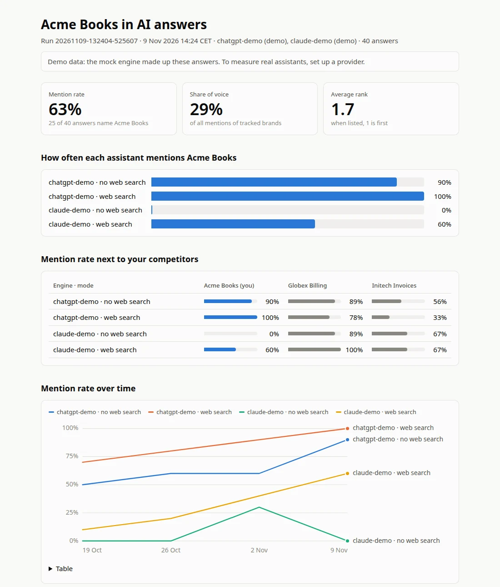

# llmention

**See how often AI assistants mention your product.**

llmention is an open-source command-line tool. It asks AI assistants like
ChatGPT and Claude the questions your buyers ask, and it counts how often each
assistant names your product. It does the same for your competitors and lists
the websites the answers cite as sources. If you run it every week, you see
whether your product comes up more often or less.

llmention sends the questions through the providers' APIs, with your own API
keys. It runs on your computer and saves its history in a folder next to its
settings file. You don't need an account, and there is no llmention server.

<p align="center"><a href="docs/quickstart.md">Quickstart</a> · <a href="docs/metrics.md">What the numbers mean</a> · <a href="docs/README.md">Docs</a> · <a href="AGENTS.md">AGENTS.md</a></p>

## Set it up with your coding agent

Paste this into your coding agent, such as Claude Code or Codex, inside your
product's repository:

```text
Set up llmention for this product.
Use https://github.com/vincentsch/llmention: read its AGENTS.md and follow
the steps. Write llmention.yaml with our competitors, show me the dry run
and its cost, then run it once and show me the report.
```

The agent reads your project to find out what your product is called and what
it does. It also looks for the products you compete with. Then it installs
llmention and writes the settings file, `llmention.yaml`, with the questions to
ask. Before anything is sent, it shows you a dry run with the number of
requests and the estimated cost. Ten questions on two providers come to about
$0.60 at October 2026 list prices. [AGENTS.md](AGENTS.md) lists each step the
agent takes.

## Try it without an API key

```sh
curl -fsSL https://raw.githubusercontent.com/vincentsch/llmention/main/install.sh | sh
llmention demo
```

If the installer prints a PATH command, run that first. The demo makes up a
small market. Acme Books sells invoicing software, and Globex Billing and
Initech Invoices compete with it. Two demo engines, which stand in for ChatGPT
and Claude, answer ten buyer questions with and without web search. The answers
are made up, but the report looks the same as the one you get for your own
product:

```text
Acme Books · run 20261026-193142-6edf67 · 26 Oct 2026 20:31
Engines: chatgpt-demo (demo), claude-demo (demo)
Competitors: Globex Billing, Initech Invoices
10 prompts, 40 answers
Demo data: the mock engine made up these answers. To measure real assistants, set up a provider.

How often assistants mention Acme Books
  Engine        Mode           Mentioned  Rate  Share of voice  Avg. rank
  chatgpt-demo  no web search  9 of 10    90%   37%             2.4
  chatgpt-demo  web search     9 of 10    90%   37%             2.2
  claude-demo   no web search  1 of 10    10%   7%              1.0
  claude-demo   web search     5 of 10    50%   19%             1.6
  Rate is the share of counted answers that name Acme Books. Share of voice is its part of all mentions of the brands you track.
  Avg. rank is its average place in the answers that name it, where 1 means first. A dash means there was nothing to count.

Mention rate next to your competitors
  Engine · mode                 Acme Books (you)  Globex Billing  Initech Invoices
  chatgpt-demo · no web search  90%               89%             56%
  chatgpt-demo · web search     90%               89%             67%
  claude-demo · no web search   10%               89%             67%
  claude-demo · web search      50%               100%            67%

Sites the answers cited
  Site                Citations  In answers  Whose
  acme-books.example  11         11          yours
  youtube.com         11         11
  globex.example      9          9           Globex Billing
  g2.com              8          8
  ...

What stands out
  - claude-demo mentioned Acme Books more often with web search on (50%) than off (10%).
  - The most cited sites outside the brands you track were youtube.com (11) and g2.com (8).
  ...
```

Each row of the first table is one assistant in one mode. The mention rate
(Rate) is the share of answers that name your product. chatgpt-demo named Acme
Books in 9 of 10 answers without web search, so its mention rate there is 90%.
Answers to questions that already name you are left out. They tell you nothing
about whether the assistant would bring you up by itself.

Share of voice is your part of all the mentions of the brands you track. Say
Acme Books comes up in 3 answers and its competitors come up 7 times. Then Acme
Books has a share of voice of 30%. Only answers to questions that name none of
the tracked brands count here.

Avg. rank is your average place in the answers that name you. 1 means you came
first, for example at the top of a list of products.
[What the numbers mean](docs/metrics.md) explains each table and how llmention
finds a mention.

The full demo output also quotes some answers and shows four weeks of made-up
history. `llmention demo --keep ./llmention-demo` saves the demo project, so you
can try the other commands on it.

## Measure your product

Export an API key for each provider you want to ask. Then describe your
product:

```sh
export OPENAI_API_KEY=...
export ANTHROPIC_API_KEY=...
llmention quick --brand "Acme Books" --category "invoicing for freelancers" \
  --domain acme-books.example \
  --competitors "Globex Billing (globex.example), Initech Invoices" --dry-run
```

`quick` writes eight buyer questions about your category, such as "What are
the best tools for invoicing for freelancers?". None of them names your
product. For each of your first two competitors it adds one more question,
such as "What are good alternatives to Globex Billing?". So this example has
ten questions. `quick` also adds an engine for each provider key it finds. With
`--dry-run` it only prints what it would send:

```text
Dry run: nothing was sent.
Would send 40 requests: 10 prompts to 2 engines, in no web search and web search modes.
Failed requests are retried. The run stops at 100 requests, its budget.
Estimated cost: about $0.60, from list prices checked on 2026-10-26. Thinking tokens and extra web searches can make it higher.
```

Run the same command without `--dry-run` to write `llmention.yaml` and ask the
assistants. Then edit the questions in that file until they sound like your
buyers. From then on, use `llmention run`. If you would rather answer questions
in the terminal, `llmention init` asks for the same details one by one.
[Writing prompts](docs/prompts.md) has advice on picking questions, and
`llmention discover` suggests more.

The model names in `llmention.yaml` were current in October 2026. You can
change them to any model your key can use. [Providers and models](docs/providers.md)
covers the other providers. It also shows how to use a gateway or a model that
runs on your own computer.

## Read the report

`llmention report` shows the latest run again. These options show more:

```sh
llmention report --answers          # every answer, grouped by question
llmention report --diff             # what changed since the run before
llmention report --trend            # mention rate across recent runs
llmention report --html report.html # one file to share
```

<p align="center">
  <picture>
    <source media="(prefers-color-scheme: dark)" srcset="docs/media/report-dark.webp">
    
  </picture>
</p>

## Track it every week

Answers change when providers update their models and when new pages appear on
the web. If you run llmention every week, you see which way your numbers go.
This GitHub Actions job runs every Monday. It saves each run in your repository
and adds the trend to the job's summary page:

```yaml
on:
  schedule: [{cron: "0 6 * * 1"}]
  workflow_dispatch:
permissions:
  contents: write
jobs:
  llmention:
    runs-on: ubuntu-latest
    steps:
      - uses: actions/checkout@v7
      - run: |
          curl -fsSL https://raw.githubusercontent.com/vincentsch/llmention/main/install.sh | sh
          echo "$HOME/.local/bin" >> "$GITHUB_PATH"
      - run: llmention run --fail-under mention-rate=30%
        env:
          OPENAI_API_KEY: ${{ secrets.OPENAI_API_KEY }}
          ANTHROPIC_API_KEY: ${{ secrets.ANTHROPIC_API_KEY }}
      - if: always()
        run: |
          llmention report --trend --format markdown >> "$GITHUB_STEP_SUMMARY"
          git config user.name "github-actions[bot]"
          git config user.email "41898282+github-actions[bot]@users.noreply.github.com"
          git add .llmention/runs
          git diff --cached --quiet || { git commit -m "Weekly llmention run" && git push; }
```

`--fail-under` makes the job fail when your mention rate in any engine and mode
is below 30%. The saved runs hold the full answers, so use a private repository
for this.
[Scheduled runs](docs/ci.md) shows how to run it with cron and how to get an
alert. It also explains how to store the history somewhere else.

## What the API can and can't tell you

llmention asks the same models the assistants use, through the API. A person
in the ChatGPT or Claude app can still get a different answer. The apps add
their own instructions and what they remember about the user, and their search
can find other pages than the API's search tool. Answers also vary from one
request to the next. So the numbers are most useful as a trend over the weeks
and next to your competitors. [Modes](docs/modes.md) explains what each mode
sends and where API answers and app answers differ.

A mention means the answer contains your product name or one of its other
names, which llmention calls aliases. llmention does not judge whether a
mention was positive. If you want that, set up an
[AI grader](docs/configuration.md#ai-grader), a second model that reads each
answer.

## Docs

- [Quickstart](docs/quickstart.md)
- [Writing prompts](docs/prompts.md)
- [What the numbers mean](docs/metrics.md)
- [Modes, and why API answers differ from the app](docs/modes.md)
- [Providers and models](docs/providers.md)
- [Costs and the request budget](docs/costs.md)
- [Scheduled runs in CI or cron](docs/ci.md)
- [llmention.yaml reference](docs/configuration.md)
- [FAQ](docs/faq.md) and [troubleshooting](docs/troubleshooting.md)
- [Command reference](docs/cli/index.md)
- [Research suites](examples/research/README.md) for factual accuracy tests

## Install options

The installer works on Linux and macOS, and on Windows through Git Bash. It
downloads the program for your system and checks its SHA-256 checksum. Then it
installs it to `~/.local/bin`, or to `INSTALL_DIR` if you set it. With Go
installed you can also run:

```sh
go install github.com/vincentsch/llmention/cmd/llmention@latest
```

[CONTRIBUTING.md](CONTRIBUTING.md) explains how to build from source and run
the tests. Report security issues through [SECURITY.md](SECURITY.md).

Built with [rungrad](https://rungrad.com).

## License

[MIT](LICENSE). Made by [Vincent Schmalbach](https://www.vincentschmalbach.com/).
